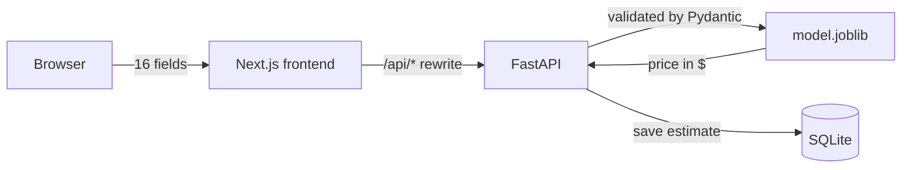

# House Price Prediction

Estimate the sale price of a house in **Ames, Iowa** from a 16-field web form.
An end-to-end machine learning project: exploratory analysis, a tested scikit-learn preprocessing
pipeline, a comparison of linear and tree models, error analysis and interpretation, and a web app
built with **FastAPI** and **Next.js**.

**Live demo:** [housepriceprediction.getastrobyte.com](https://housepriceprediction.getastrobyte.com)
(the API runs on a free instance that sleeps when idle, so the first estimate can take up to a minute)

<!-- Screenshot of the app: add docs/screenshot.png and uncomment the line below -->
<!--  -->

## Results

All models were evaluated on the same 5 cross-validation folds, with **out-of-fold predictions**:
every house is predicted by a model that never saw it.

| Model | MAE ($) | RMSE ($) | RMSE (log) |
|---|---:|---:|---:|
| Baseline (median price) | 55,031 | 78,697 | 0.3974 |
| Ridge (`alpha=300`) | 13,881 | 20,618 | 0.1148 |
| **Lasso (`alpha=0.003`)** | **13,339** | **19,990** | **0.1110** |
| XGBoost (tuned) | 13,440 | 20,932 | 0.1125 |

RMSE on log prices is the competition metric: an error of 0.11 means a typical relative error of
about 11%.

**The model behind the web app** uses only the 16 form fields and scores **0.122 ± 0.006** RMSE (log)
in 5-fold cross-validation. That is a cost of about 1,500 $ per house compared to the full 79-column
model. For a normal sale, its estimate is typically within **±7%** of the actual price.

### Key findings

- **Lasso is the best model, but only just.** Its lead over XGBoost (0.0015) is well below the
  fold-to-fold standard deviation (~0.005), so the two are tied in practice. Lasso was chosen because
  it is simpler, faster and its coefficients can be read directly. After the log target, ordinal
  scales and derived totals, the price is mostly a sum of independent effects; even XGBoost preferred
  very shallow trees (depth 2).
- **No systematic bias.** The mean residual is close to 0 for every sale condition, neighborhood and
  predicted price band. What differs is predictability: normal sales are within ~7%, while
  foreclosures and family sales are about twice as hard to predict, and old, mixed neighborhoods
  (IDOTRR: 17%) are much harder than new, homogeneous ones (College Creek: 5%).
- **What drives the price.** Size and overall quality dominate. One more quality point (1-10) adds
  ~5.3% to the price, 100 sq ft of living area ~2.5%, one more garage space ~2.7%. Commercial zoning
  lowers it by ~2.8%.
- **A statistical trap avoided.** Grouping errors by the *actual* price makes the model look biased
  (cheap houses "overestimated", expensive ones "underestimated"). That is regression to the mean.
  Grouping by the *predicted* price, which is what a user sees, shows no bias.
- **Train on what you will receive.** Feeding the 16 form fields to the full model, with defaults for
  the other columns, raises the error to 0.159. Training the model on the same masked input it gets
  in production brings it back to 0.122.

## How it works



**The model** is a single scikit-learn pipeline, saved with `joblib`:

1. **`FormInputMasker`:** keeps the 16 form fields and fills the other columns with training defaults
   (median / most frequent value).
2. **Preprocessing:** custom transformers for structural missing values (no garage means every garage
   column is "None"/0), neighborhood-based imputation of `LotFrontage`, derived totals (`TotalSF`,
   `TotalBath`, `TotalPorchSF`), ordinal encoding of quality scales, one-hot encoding with rare
   categories grouped. Details in [`backend/docs/preprocessing.md`](backend/docs/preprocessing.md).
3. **Scaling and Lasso**, wrapped in a `TransformedTargetRegressor`: the model learns `log(price)`
   but takes and returns dollars.

**The API** validates every request before it reaches the model: value ranges, the 25 known
neighborhoods, and cross-field rules (a house cannot be remodeled before it was built, the finished
basement cannot exceed the basement, and the living area must stay within the 4,000 sq ft seen in
training). Every successful estimate is stored in SQLite and listed by `GET /predictions`.

**The frontend** is a Next.js app with the form, the estimate, the recent estimates, a light / system /
dark theme and a mobile layout.

## Project structure

```
├── backend/                          Python project (uv)
│   ├── notebooks/
│   │   ├── 01_eda.ipynb              exploration and data-quality decisions
│   │   ├── 02_preprocessing.ipynb    missing-value groups, derived features
│   │   ├── 03_modeling.ipynb         baseline, Ridge, Lasso, XGBoost, tuning
│   │   └── 04_error_analysis.ipynb   residuals, feature effects, web form fields
│   ├── src/housepriceprediction/
│   │   ├── transformers/             custom scikit-learn transformers
│   │   ├── data.py                   loading rules (NA handling, outliers)
│   │   ├── features.py               column groups and the 16 form fields
│   │   ├── preprocessing.py          the preprocessing pipeline
│   │   ├── modeling.py               model pipelines, final pipeline
│   │   ├── train.py                  training script (uv run train)
│   │   └── api/                      FastAPI app, Pydantic schemas, SQLite
│   ├── tests/                        pytest suite
│   └── docs/preprocessing.md         preprocessing specification
└── frontend/                         Next.js app (TypeScript, Tailwind, pnpm)
```

## Running locally

**Requirements:** [uv](https://docs.astral.sh/uv/) (installs Python 3.13 by itself), Node.js and
[pnpm](https://pnpm.io/).

**1. Get the data.** The dataset is not included in this repository (see [Data](#data)). Download
`train.csv` and `test.csv` from the
[Kaggle competition](https://www.kaggle.com/c/house-prices-advanced-regression-techniques/data)
into `backend/data/raw/`.

**2. Train the model and start the API:**

```bash
cd backend
uv sync                      # create .venv and install dependencies
uv run train                 # cross-validation, then saves models/model.joblib and model.json
uv run uvicorn housepriceprediction.api.main:app --reload
```

The API runs on http://localhost:8000, with interactive documentation at
http://localhost:8000/docs.

**3. Start the frontend**, in a second terminal:

```bash
cd frontend
pnpm install
pnpm dev
```

Open http://localhost:3001. Requests to `/api/*` are forwarded to the API; set `BACKEND_URL` if the
API runs elsewhere.

**Tests:**

```bash
cd backend && uv run pytest     # tests that need the data or the trained model are skipped without them
cd frontend && pnpm lint
```

## Deployment

| Part | Host | Settings |
|---|---|---|
| Frontend | Vercel (Hobby) | root directory `frontend`, environment variable `BACKEND_URL` = the API address (set before the build: rewrites are resolved at build time) |
| API | Render (free) | root directory `backend`, build `uv sync --frozen --no-dev`, start `uv run --frozen --no-dev uvicorn housepriceprediction.api.main:app --host 0.0.0.0 --port $PORT`, `PYTHON_VERSION=3.13.13` |
| Domain | Cloudflare DNS | CNAME to the value shown by Vercel, set to **DNS only** |

The trained model (`backend/models/model.joblib`) is committed so the API can start without the
training data. On the free Render instance the SQLite history is reset whenever the service restarts.

## API

| Method | Path | Description |
|---|---|---|
| `GET` | `/health` | `{"status": "ok"}` when the model is loaded |
| `POST` | `/predict` | 16 house fields → `{"predicted_price": ...}`; invalid input → 422 |
| `GET` | `/predictions?limit=10` | most recent estimates (1-100) |

## Limitations

The model knows a single market: **1,456 house sales in Ames, Iowa, from 2006 to 2010, in US
dollars**. It is not meant for other cities, countries or periods, and the API rejects houses above
4,000 sq ft of living area, which were excluded from training.

**Using it for another market.** Fork the repository and bring your own data. The pipeline,
validation, training script, API and frontend can be reused, but the exploratory analysis, the
preprocessing (column groups, missing-value rules) and the form fields must be rebuilt for the new
dataset.

## Data

Ames Housing dataset by Dean De Cock (*Journal of Statistics Education*, 2011), distributed through
the Kaggle competition
[House Prices: Advanced Regression Techniques](https://www.kaggle.com/c/house-prices-advanced-regression-techniques).
The competition rules allow non-commercial use only and do not allow redistributing the data, so the
CSV files are not part of this repository and the web app shows only model estimates.

## Tech stack

Python 3.13 · uv · pandas · scikit-learn · XGBoost · pytest · FastAPI · Pydantic · SQLModel / SQLite ·
Next.js · TypeScript · Tailwind CSS · pnpm

## License

[Apache License 2.0](LICENSE)
